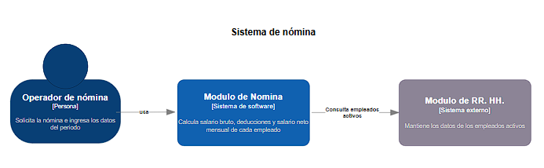
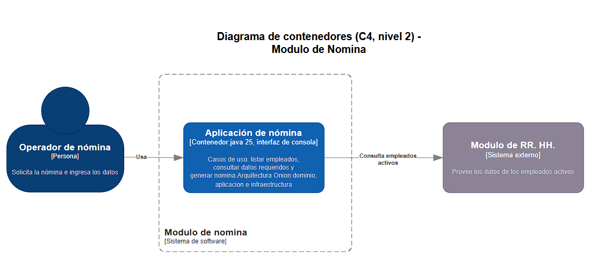
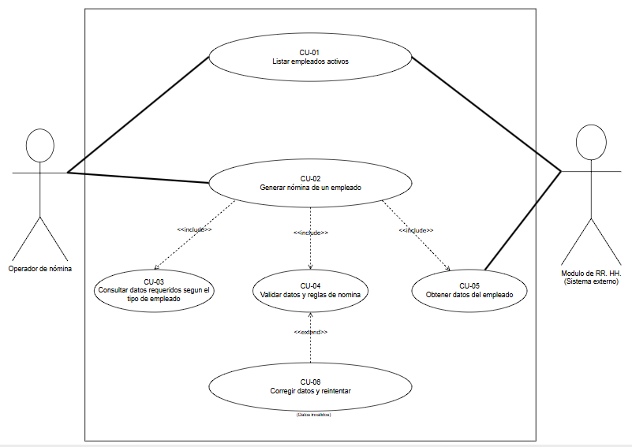

# Especificación de requisitos de software (SRS) - Módulo de Nómina

## 1. Introducción

### 1.1 Propósito y contexto

El Módulo de Nómina es un componente de un sistema empresarial organizado en microservicios. Su función es calcular el salario bruto, las deducciones y el salario neto mensual de los empleados activos de la empresa, según su tipo de contratación: asalariado, por horas, por comisión o temporal. Cada tipo de empleado tiene su propia forma de calcular el salario, sus bonos y sus beneficios.

El módulo trabaja de la mano con el Módulo de Recursos Humanos (RR. HH.): toda la información de los empleados proviene de allí. Los demás módulos del sistema no se describen en este documento.

### 1.2 Alcance y límites del sistema

#### Dentro del alcance

El módulo permitirá:

1. **Listar los empleados activos** obtenidos desde el Módulo de RR. HH.
2. **Consultar los datos requeridos** para calcular la nómina de un empleado, que dependen de su tipo.
3. **Generar la nómina mensual** de un empleado, con un desglose que incluye:
   - Salario bruto: salario fijo mensual, pago por horas trabajadas (con horas extras a 1,5 veces la tarifa por encima de 40 horas) o salario base más comisión por ventas.
   - Bonos: bono por antigüedad del asalariado con más de 5 años y bono por ventas altas del empleado por comisión.
   - Beneficios: bono de alimentación de $1.000.000 mensuales para asalariados y empleados por comisión, y aporte al fondo de ahorro del 2 % para el empleado por horas elegible (más de 1 año de antigüedad y que acepte participar).
   - Deducción de seguro social y pensión: 4 %.
   - Salario neto.
4. **Validar los datos**, rechazando horas trabajadas negativas, ventas negativas, montos negativos y cualquier nómina cuyo salario neto resulte negativo.
5. **Permitir corregir los datos** y reintentar el cálculo cuando alguna validación falla.

#### Fuera del alcance

El módulo no incluirá:

- Registro, actualización ni eliminación de empleados y contratos, que son responsabilidad del Módulo de RR. HH.
- Almacenamiento de las nóminas calculadas en esta versión.
- Autenticación, usuarios o roles.
- Pagos o transferencias bancarias reales.
- Retención en la fuente, prestaciones sociales (cesantías, primas, vacaciones) y cualquier descuento o aporte que no esté en las reglas de negocio. La ARL la asume la empresa y no se descuenta al empleado.
- Desprendibles de pago en PDF, reportes históricos o consolidados de varios meses.
- Control de asistencia y registro de ventas.
- Integración con sistemas externos distintos de RR. HH.
- Descripción o implementación de otros módulos del sistema.

### 1.3 Diagrama de contexto (C4, nivel 1)

## 2. Descripción general del sistema

### 2.1 Actores y límites del sistema

- **Operador de nómina:** usuario que selecciona al empleado e ingresa los datos del período. Es un actor externo al módulo.
- **Módulo de Recursos Humanos:** sistema externo con el que Nómina se comunica. Es la fuente de los datos de los empleados activos.

**Frontera del módulo:** pertenecen al Módulo de Nómina las reglas de cálculo, los casos de uso y la interfaz de consola. El operador y el Módulo de RR. HH. quedan fuera. La única comunicación con otro módulo es la que mantiene con RR. HH.

### 2.2 Diagrama de contenedores (C4, nivel 2)

### 2.3 Casos de uso

### 2.4 Entorno, supuestos y restricciones

**Entorno:** el módulo se ejecuta como un servicio del sistema de microservicios, con interfaz de consola, y se comunica con el Módulo de RR. HH.

**Supuestos:**

- La nómina se calcula por mes y por empleado.
- Solo se calcula la nómina de empleados activos en RR. HH.
- En la versión actual, la conexión con RR. HH. se simula con un repositorio de empleados en memoria.
- Los datos propios de cada cálculo (por ejemplo horas, ventas, tarifa, salario y antigüedad) los ingresa el operador. A futuro, los que correspondan a empleados y contratos provendrán de RR. HH.

**Restricciones técnicas:**

- Java 25, con programación orientada a objetos y Maven.
- Principios SOLID, código limpio, refactorización y comentarios en el código.
- Pruebas unitarias, con TDD en la lógica de dominio.
- Arquitectura Onion, con las capas de dominio, aplicación e infraestructura.
- Control de versiones en GitHub y metodología Kanban.

## 3. Reglas de negocio (RN)

- **RN-01. Tipos de empleados:** el módulo maneja cuatro tipos de empleados: asalariados, por horas, por comisión y temporales.
- **RN-02. Empleados activos:** solo se calcula la nómina de los empleados activos, cuyos datos provienen del Módulo de RR. HH.
- **RN-03. Salario del asalariado:** el empleado asalariado recibe un salario fijo mensual.
- **RN-04. Bono por antigüedad:** el asalariado con más de 5 años de antigüedad recibe un bono mensual equivalente al 10 % de su salario fijo.
- **RN-05. Salario del empleado por horas:** se calcula como la tarifa por hora multiplicada por las horas trabajadas. Las horas que superan las 40 se pagan a 1,5 veces la tarifa normal.
- **RN-06. Bonos del empleado por horas:** el empleado por horas no recibe bonos.
- **RN-07. Salario del empleado por comisión:** recibe un salario base más una comisión sobre las ventas del mes, con el porcentaje que indica el operador. Si las ventas superan $20.000.000, recibe además un bono adicional del 3 % sobre las ventas.
- **RN-08. Salario del empleado temporal:** recibe un salario fijo mensual establecido en su contrato y no recibe bonos ni beneficios adicionales.
- **RN-09. Deducción de seguro social y pensión:** a todos los empleados se les descuenta el 4 % de su salario bruto, incluidos los bonos.
- **RN-10. ARL:** el costo de la ARL lo asume la empresa y no se descuenta al empleado.
- **RN-11. Beneficio de alimentación:** los empleados permanentes (asalariados y por comisión) reciben un beneficio de alimentación de $1.000.000 mensuales, cubierto por la empresa.
- **RN-12. Elegibilidad para el fondo de ahorro:** el empleado por horas puede acceder al fondo de ahorro si tiene más de 1 año de antigüedad y acepta participar.
- **RN-13. Aporte al fondo de ahorro:** el empleado por horas elegible aporta mensualmente el 2 % de su salario bruto al fondo de ahorro.

## 4. Requisitos funcionales (RF)

- **RF-01. Listar empleados activos:** el módulo debe obtener y mostrar la lista de empleados activos desde el Módulo de RR. HH.
- **RF-02. Consultar datos requeridos:** al seleccionar un empleado, el módulo debe indicar qué datos se necesitan para calcular su nómina según su tipo (por ejemplo, horas trabajadas para el empleado por horas y ventas del mes para el empleado por comisión).
- **RF-03. Cálculo del salario bruto por tipo:** el módulo debe calcular el salario bruto de cada empleado según su tipo, aplicando el salario fijo, las horas trabajadas con sus horas extras, o el salario base con la comisión por ventas.
- **RF-04. Aplicación de bonos:** el módulo debe calcular y aplicar los bonos que correspondan: el bono por antigüedad del asalariado y el bono por ventas altas del empleado por comisión.
- **RF-05. Aplicación del beneficio de alimentación:** el módulo debe aplicar el beneficio de alimentación a los empleados permanentes.
- **RF-06. Verificación de elegibilidad para el fondo de ahorro:** el módulo debe verificar que el empleado por horas tenga más de 1 año de antigüedad y haya aceptado participar antes de habilitar su aporte.
- **RF-07. Cálculo del aporte al fondo de ahorro:** el módulo debe calcular el aporte mensual del 2 % para los empleados por horas que cumplan las condiciones de elegibilidad.
- **RF-08. Aplicación de deducciones y cálculo del salario neto:** el módulo debe calcular la deducción de seguro social y pensión (4 %) y determinar el salario neto.
- **RF-09. Validación de datos y reintento:** el módulo debe validar los datos ingresados, informar el error cuando no sean válidos y permitir corregirlos para volver a calcular.
- **RF-10. Presentación del desglose de nómina:** el módulo debe mostrar el desglose de la nómina calculada: salario bruto, bonos, beneficios, deducciones y salario neto.

## 5. Requisitos no funcionales (RNF)

- **RNF-01. Validación del salario neto:** el módulo debe garantizar que el salario neto de un empleado nunca sea negativo.
- **RNF-02. Validación de horas trabajadas:** el módulo debe impedir el ingreso de horas trabajadas negativas.
- **RNF-03. Validación de ventas:** el módulo debe impedir el registro de ventas negativas para los empleados por comisión.
- **RNF-04. Precisión en los cálculos monetarios:** el módulo debe usar un tipo de dato adecuado para valores monetarios en los cálculos de salarios, bonos, deducciones y beneficios, evitando errores de precisión y redondeo.
- **RNF-05. Mantenibilidad:** el código debe desarrollarse aplicando los principios SOLID, las buenas prácticas de código limpio y la arquitectura Onion, para facilitar su comprensión, modificación y mantenimiento.
- **RNF-06. Usabilidad básica:** la interfaz de consola debe ser clara, con listas numeradas, indicaciones de los datos solicitados y mensajes de error comprensibles.
- **RNF-07. Facilidad de pruebas:** la lógica de dominio debe poder verificarse con pruebas unitarias, desarrollada con TDD.
- **RNF-08. Independencia de la fuente de datos:** el acceso a los empleados debe hacerse mediante una interfaz de repositorio, de modo que la simulación en memoria pueda reemplazarse por la conexión real con RR. HH. sin modificar el dominio ni los casos de uso.
