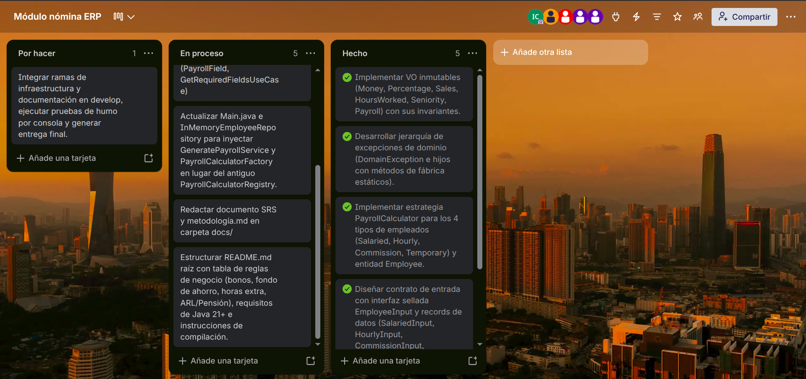

# Metodología de desarrollo - Módulo de Nómina

## 1. Metodología de organización: Kanban

El equipo organizó el trabajo con **Kanban**, un método que ayuda a ver y ordenar las tareas de un proyecto. Se basa en tres ideas:

- **Visualizar el trabajo:** cada tarea es una tarjeta en un tablero, y las columnas indican en qué estado está (por ejemplo, por hacer, en curso y terminada).
- **Limitar el trabajo en curso:** se evita que cada persona tenga muchas tareas abiertas al mismo tiempo, para terminar lo que se empieza.
- **Flujo continuo:** las tareas avanzan por las columnas a medida que se completan, sin esperar a ciclos de duración fija. Esto permite repartir el trabajo y ajustarlo cuando cambian los requisitos.

Se eligió Kanban por ser ligero y adecuado para un equipo pequeño. Los requisitos del proyecto cambiaron durante el desarrollo (el sistema pasó de ser una aplicación aislada a un módulo de microservicios con arquitectura Onion), y Kanban permitió incorporar esos cambios sin replanificar todo.

## 2. Cómo se aplicó

El equipo trabajó con un tablero Kanban llamado **Módulo nómina ERP**, con tres columnas:

- **Por hacer:** tareas pendientes, como integrar las ramas de infraestructura y documentación en `develop`, ejecutar pruebas de humo por consola y generar la entrega final.
- **En proceso:** tareas en desarrollo, como actualizar `Main.java` y el repositorio en memoria para usar el nuevo servicio de generación de nómina, redactar el SRS y la metodología en la carpeta `docs/`, y estructurar el README.
- **Hecho:** tareas terminadas, como implementar los objetos de valor inmutables (dinero, porcentaje, ventas, horas trabajadas, antigüedad y nómina), desarrollar la jerarquía de excepciones del dominio, implementar la estrategia de cálculo de nómina para los cuatro tipos de empleados y diseñar el contrato de entrada con una interfaz sellada.

Cada tarea se registró como una tarjeta que avanzaba de izquierda a derecha según su estado. Así, en cualquier momento el equipo podía ver quién hacía qué y qué faltaba, y las tareas nuevas que surgieron con el cambio de arquitectura se agregaron al tablero sin replanificar todo.

### Tablero Kanban

## 3. Control de versiones con Git y GitHub

El código y la documentación se gestionan en un repositorio de GitHub, con el siguiente flujo:

1. Cada integrante hace un **fork** del repositorio principal, que es una copia propia donde puede trabajar sin afectar el proyecto.
2. El trabajo se hace en una **rama por funcionalidad**, con nombres descriptivos como `feat/domain` o `feat/docs`.
3. Los cambios se guardan en **commits** con mensajes que indican el tipo de cambio, por ejemplo `feat:` para una funcionalidad nueva, `refactor:` para una mejora del código sin cambiar su comportamiento y `docs:` para documentación.
4. Al terminar, se envía un **pull request** al repositorio principal. El equipo revisa los cambios y, si están bien, se integran.

Este flujo deja registro de quién cambió qué y cuándo, y evita que el código principal se modifique sin revisión.

## 4. Prácticas de desarrollo

- **Arquitectura Onion:** el código se organiza en tres capas (dominio, aplicación e infraestructura). Las dependencias apuntan siempre hacia el dominio, que contiene las reglas del negocio y no depende de ninguna otra capa.
- **Principios SOLID y código limpio:** cada tipo de empleado calcula su nómina en su propia clase, lo que permite agregar tipos nuevos sin modificar los existentes.
- **Refactorización:** el código se mejora de forma continua, como ocurrió al eliminar clases que dejaron de ser necesarias.
- **Pruebas unitarias y TDD:** la lógica de dominio se desarrolla verificándola con pruebas automáticas.
- **Comentarios en el código:** se documentan las clases y los métodos principales para facilitar su comprensión.

## 5. Documentación del proyecto

- **SRS (especificación de requisitos de software):** describe qué hace el módulo, sus reglas de negocio y sus requisitos. Ver [SRS.md](SRS.md).
- **ADR (registro de decisiones de arquitectura):** deja constancia de las decisiones importantes y de por qué se tomaron, como la elección de la arquitectura Onion.
- **Diagramas C4 y de casos de uso:** muestran el contexto, los contenedores y las funciones del módulo. Están incluidos en el SRS.
